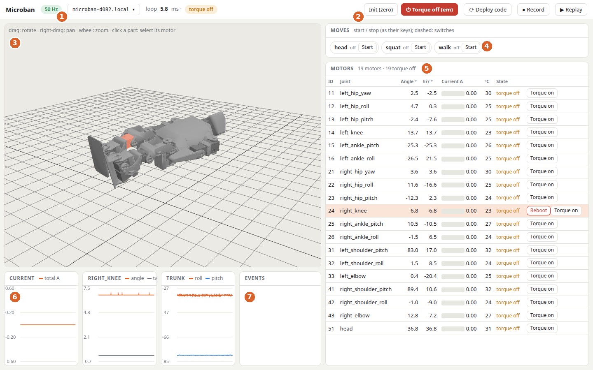
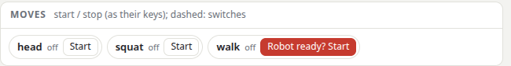
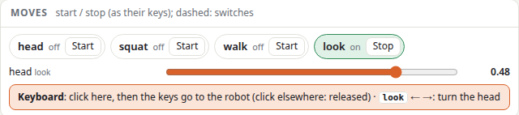
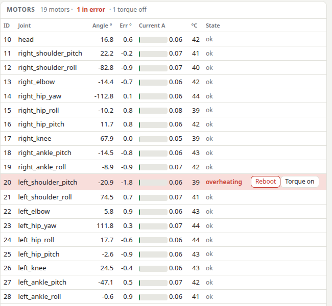
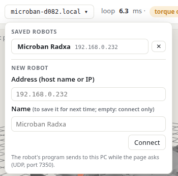
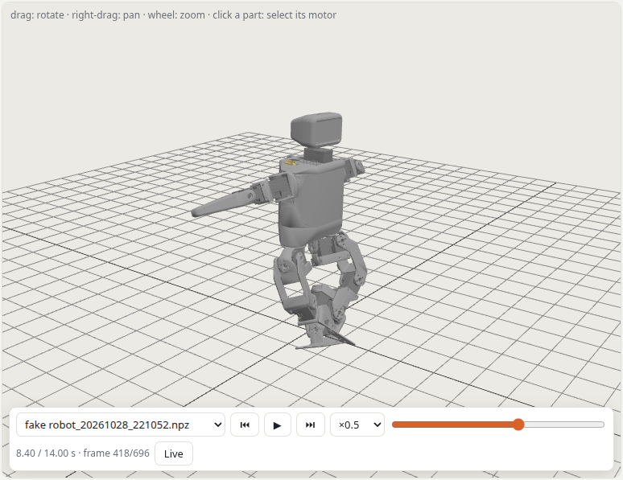
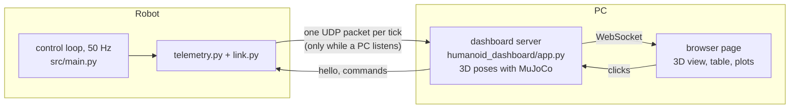

# Live dashboard

A page on your PC that shows the robot live, about 50 times a second: its 3D pose, every motor, the trunk orientation,
plots and messages. It also starts and stops the moves, deploys your code, and records and replays a run.



| | What | |
| :---: | :--- | :--- |
| 1 | **Link and robot** | link rate (green: data arrives), the robot shown (click to change it), its version (Classic / Climber), the loop time, torque on / off |
| 2 | **Whole-robot buttons** | **Init (zero)**, **⏻ Torque off (em)**, **⟳ Deploy code**, **● Record**, **▶ Replay** |
| 3 | **3D view** | the robot as it is (drag: rotate, right-drag: pan, wheel: zoom); click a part to select its motor |
| 4 | **Moves** | every move of the robot, with Start / Stop and its state (off, on, stopping); the moves' sliders and keyboard zone |
| 5 | **Motors** | ID, joint, angle, error to its target, current, temperature, state, Reboot / Torque buttons |
| 6 | **Plots** | the last 10 s: total current, the selected motor's angle and target, the trunk's roll and pitch |
| 7 | **Events** | the robot's messages, the answers to your commands, your moves' `print()` (`move: text`), and a move file that does not load |

## Start it

**On the robot, once:** `make robot-service-enable HOST=radxa@<robot>` installs the robot service: the control loop
(`src/main.py`, what `make run` runs) starts at every boot, the torque off until a move is launched. A robot flashed
from the [SD card image](sd_image.md) has it already. It is the robot's program itself, not an extra one: it costs
nothing more while no dashboard watches.

**On the PC, when you want to watch:**

```bash
make dashboard                                    # opens http://127.0.0.1:8780 on the robot picker
make dashboard HOST=microban-1a2b.local           # straight to that robot
```

`HOST` is the robot's host name or IP (`radxa@...` as for `make deploy` works too: the page takes the host); without
it, the page opens on its robot picker. `make discover-robots` lists the robots on the network. Close the page any time: the robot does not depend on it.

| Commands of the robot service | |
| :--- | :--- |
| `make robot-service-stop` / `-start` | before / after a tool that talks to the motors on the robot (`tools/motor_setup.py`, `tools/motor_ids.py`); `make run` stops it for you |
| `make robot-service-logs` | follow the robot program's output |
| `make robot-service-disable` | remove the service |

## Moves and your code



**Start** asks to confirm (a second click within 3 s): the torque goes on where the robot is (or, for a move that asks
it, after a 2 s ramp to the neutral pose), then the move runs.
**Stop** stops it. A move you write in `src/moves/` appears here by itself after **⟳ Deploy code** (or `make deploy`),
which saves the robot's code as it was (`~/microban_backups/`, the last 5: `make restore`), sends yours and restarts
its program; see [moves.md](moves.md). Deploy needs your SSH key on
the robot (`ssh-copy-id radxa@<robot>`); it shows its progress in the Events. A move's ⚙ button edits the variables
it exposes, live; **Save on robot** keeps them for the next start.

A move can be driven live: while it runs, its sliders show under the moves (each starts at its start value; click
the number at its end to type a value), and a **Keyboard** zone when it reads keys. Click
the zone (it turns orange), then the keys you hold go to the robot; click elsewhere (or Esc) and they are released.
The moves' code: [moves.md](moves.md#drive-it-live-sliders-and-keys); try the `look` move (the head follows its
slider, or the ← → keys), or `walk` (the arrows walk at its speed slider, a fraction of the maximum speed; the
gamepad still works when no arrow is held).



## A motor in error



A motor in overheating or overload error turns red, in the table and in the 3D view (its servo glows), and the Events
say so. **Reboot** clears the error (the motor restarts with its torque off: **Torque on** puts it back, after a
confirmation). A reboot takes 0.1 to 1.5 s, during which the control loop pauses and the other motors hold their last
target. A hot motor (within 10 °C of its 70 °C limit) is shown in orange.

## Choosing the robot



The button next to the link rate opens the robot picker: click a saved robot, or type a new address (host name or IP);
give it a name to save it for next time (kept on this PC in `~/.config/humanoid_dashboard/robots.json`).

**Robot version.** The robot knows which version it is: **Classic** (walking hands and feet) or **Climber** (the
climbing forearms and feet). The header shows it (*robot version*), the 3D view uses its model, and the Moves list
shows only the moves made for it (each move says it: [moves.md](moves.md)); the robot refuses the others, from the
keyboard or the gamepad too. To change it, choose another one in that menu and confirm: this changes the robot itself
(saved on it in `robot_variant.txt`, for every PC; its moves for the other version stop). A robot that was never set
is a Classic.

## Record and replay



**● Record** saves the run in `recordings/` (one file per run; a recording is cut in two if the robot restarts).
**▶ Replay** plays it back in the same page: the 3D view, the table, the moves and the plots follow. Play / pause
(space), speed ×0.1 to ×2, one frame back or forward (← →; with shift: one second), the slider to jump anywhere,
**Live** to come back. The robot keeps running meanwhile; its commands are hidden in the replay, except em.

## Torque, em and init

As on Rhoban's other robots, the motors have no torque until a move is launched (keyboard, gamepad, or the Moves
list): the torque then goes on where the robot is, or after a 2 s ramp to the neutral pose for a move that asks it
(`start_pose`, [moves.md](moves.md#settings-of-the-class)), and the move starts. When no move runs any
more, the torque goes off again. The two whole-robot buttons:

* **⏻ Torque off (em)**: emergency stop, the moves stop and every motor goes limp at once;
* **Init (zero)**: the moves stop, every motor goes to its zero in 2 s (the shoulders: arm forward) and stays there.

After either, nothing restarts by itself: the next launch leaves em / init (**Start** in the Moves list, or a key /
button pressed to turn a move on). Keys and buttons toggle: a move still toggled on by one is off, press it twice (off,
then on) to launch it, or click its Start; once a launch leaves em / init, the moves still toggled on start too.

A move that ends by itself (its `step` returned None) or stopped by an error also stays off while its key or button
still holds it: press it again, or click Start.

## How it works



The robot only sends what its control loop already reads, in one UDP packet per tick (port 7350), and only while a
dashboard asks for it (a `hello` every second): no extra bus traffic while nobody watches. While one listens, the loop
also reads the motors' health (torque, hardware error, voltage, temperature) once a second (two small reads, ~1.5 ms).
The page's commands run in the control loop between two ticks. Everything else (kinematics, 3D, plots, recording)
runs on the PC: `src/humanoid_dashboard` ([its README](../src/humanoid_dashboard/README.md)), which does not depend on
Microban and can serve other robots. Only the page served by your dashboard may use it: another web page or site is
refused.

The input voltage error bit is always set at Microban's ~8 V (above the XL330's 7.0 V limit; Shutdown 52 does not cut
the torque for it): the page ignores it. `MICROBAN_DASHBOARD=0` turns the robot's link off.

**Without a robot**, a fake one (its joints move, a motor overheats after 15 s):

```bash
PYTHONPATH=src uv run --group dashboard python -m humanoid_dashboard.fake_robot \
    --model "$(uv run python -c 'import microban_model; print(microban_model.mjcf())')"
make dashboard HOST=127.0.0.1
```
